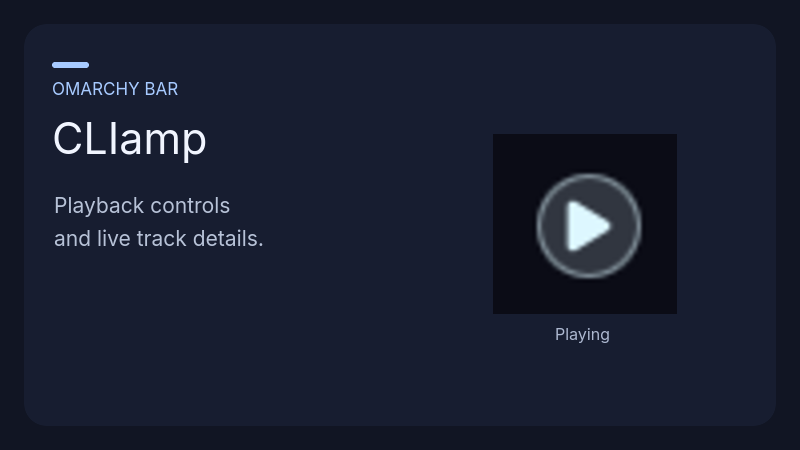

# CLIamp for Omarchy

Put playback controls for [CLIamp](https://cliamp.stream) in the Omarchy bar. The circular badge reflects playback state, and its tooltip shows the track, artist, and station when available.



## Install

Requires Omarchy 4.x with Quickshell and CLIamp 2.x on your `PATH`. The widget was tested with CLIamp 2.4.1.

```sh
omarchy plugin add https://github.com/CallMeBakugo/omarchy-cliamp.git --enable
```

Start CLIamp normally. The widget connects to the running terminal player or headless daemon over CLIamp's local interface.

## Use

- Click to pause an active track or resume playback.
- Hover for track information. The widget refreshes about every two seconds and hides when it cannot reach a running player.

For headless playback, the repository includes an optional [user service](cliamp-daemon.service) that autoplays a local playlist named `Favorites`. Review the service and edit its playlist before enabling it. The terminal player and daemon share the same socket, so run one at a time.

## Remove

```sh
omarchy plugin remove bakugo.cliamp --yes
```

If you installed the optional service, disable it with `systemctl --user disable --now cliamp-daemon.service` and remove the unit you copied into your user service directory.

[MIT license](LICENSE).
